# penfill

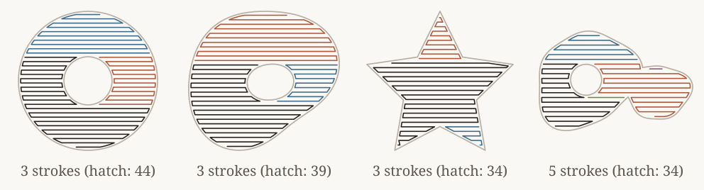

**Infill, hatching, and generative texture engine for pen plotters, CNC toolpaths, and laser engravers — in Rust, Python, Node.js, and WebAssembly.**

Give `penfill` a polygon region in millimetres and it returns the open polylines (`Strokes`) a pen should draw to fill it: boustrophedon zigzags that barely lift the pen, offset rings and spirals, geometric lattices, Poisson-disk stippling, Voronoi gravel and mud cracks, Jobard–Lefer flow streamlines, overlapping wave swells, metaball contour stacks, differential growth, 50+ cartographic geology and soil symbols, AutoCAD `.pat` hatches, dithered images, and custom patterns you write yourself.

Every built-in pattern is authored on the exact same [`Canvas` + `Tools` standard library](#build-your-own-pattern) exposed to your own code — and every pattern supports universal **perimeter edge fraying (`fray`)**, **boundary modes (`edge`: `Clip`, `Inside`, `Overflow`)**, and **polygon knockout masks (`FillOutput { strokes, mask }`)** for multi-layer compositions.

## Install

```sh
pip install penfill       # Python ≥ 3.9
npm install penfill       # Node ≥ 18, TypeScript types included
cargo add penfill         # Rust
```

The core engine is pure Rust (`i_overlay` boolean geometry, custom `SplitMix64` RNG, and Perlin/simplex noise with zero platform drift). Python, Node, and Rust produce bit-identical strokes for the same seed.

## Quick start

**Python**

```python
import penfill

outer = [(0, 0), (80, 0), (80, 60), (0, 60)]
hole  = [(30, 20), (50, 20), (50, 40), (30, 40)]
shape = penfill.Region(outer, holes=[hole])

# Classic serpentine infill
strokes = penfill.zigzag(shape, 1.2, angle=45)

# Any pattern with smooth border fraying (dissolves over 8 mm near the wall)
frayed = penfill.waves(shape, 1.5, angle=20, fray=8.0, seed=7)

# Multi-layer knockout: foreground canopy masks out background hatching
fg = penfill.canopy(shape, 6.0, seed=7, edge=("overflow", 3.0), with_mask=True)
bg = penfill.rectilinear(shape.difference(fg.mask.outset(0.4)), 1.2, angle=35)

open("plot.svg", "w").write(penfill.to_svg(fg.strokes + bg, outline=shape))
```

**Node.js**

```js
import { Region, zigzag, waves, canopy, rectilinear, toSvg } from 'penfill'
import { writeFileSync } from 'node:fs'

const shape = new Region(
  [[0, 0], [80, 0], [80, 60], [0, 60]],
  [[[30, 20], [50, 20], [50, 40], [30, 40]]],
)

const strokes = zigzag(shape, 1.2, { angle: 45 })
const frayed  = waves(shape, 1.5, { angle: 20, fray: 8.0, seed: 7 })

const fg = canopy(shape, 6.0, { seed: 7, edge: 'overflow', overflow: 3.0 })
writeFileSync('plot.svg', toSvg(strokes, shape))
```

**Rust**

```rust
use penfill::{
    fill_by_name, fill_output_by_name,
    geo::Region,
    rectilinear::fill_rectilinear,
    Anchor, EdgeMode, FillParams,
};

let outer = vec![(0.0, 0.0), (80.0, 0.0), (80.0, 60.0), (0.0, 60.0)];
let hole  = vec![(30.0, 20.0), (50.0, 20.0), (50.0, 40.0), (30.0, 40.0)];
let shape = Region::from_polygons(&[vec![outer, hole]]);

// Unified parameter builder + name dispatch
let params = FillParams::new(1.5).angle(20.0).seed(7).fray(8.0);
let frayed = fill_by_name("waves", &shape, &params).unwrap();

// Foreground fill with polygon mask export
let fg = fill_output_by_name(
    "canopy",
    &shape,
    &FillParams::new(6.0).seed(7).edge(EdgeMode::Overflow(3.0)),
).unwrap();
let bg = fill_rectilinear(&shape.difference(&fg.mask.outset(0.4)), 1.2, 35.0, None, Anchor::GLOBAL);
```

---

## Contents

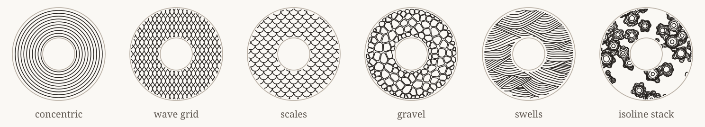

1. [How it works & Unified parameters](#how-it-works)
2. [Edge fraying (`fray`), boundary modes (`edge`), and polygon masks (`FillOutput`)](#edge-fraying-boundary-modes-and-polygon-masks)
3. [Lines and space-filling paths](#lines-and-space-filling-paths)
4. [Lattices and waves](#lattices-and-waves)
5. [Scatter and nature](#scatter-and-nature)
6. [Materials, flow, and cellular textures](#materials-flow-and-cellular-textures)
7. [Organic contours and differential growth](#organic-contours-and-differential-growth)
8. [Geology and ground textures](#geology-and-ground-textures)
9. [CAD hatch patterns (`.pat`)](#cad-hatch-patterns)
10. [Pictures: dithering and CSS-style placement](#pictures-dithering)
11. [Build your own pattern (`Canvas` & `Tools` standard library)](#build-your-own-pattern)
12. [Any shape & Gallery reference](#any-shape)
13. [Development](#development)

---

## How it works

Every fill takes a **[`Region`](src/geo.rs)** and a standardized set of parameters ([`FillParams`](src/pattern.rs)) and returns **[`Strokes`](src/geo.rs)** (or a **[`FillOutput`](src/pattern.rs)** when a knockout mask is requested).

- **`Region`**: A 2D area in millimetres consisting of one or more outer rings, each with any number of holes. Construct with `Region(outer, holes=[...])` or `Region.from_polygons([[outer, hole, ...], ...])`. Regions support exact boolean operations (`union`, `intersection`, `difference`, `xor`), polygon offsetting (`inset`, `outset`), stroke buffering (`Region.around_strokes(strokes, radius)`), point/ring queries (`contains`, `covers_ring`, `distance`), connected components (`parts`), and polyline clipping (`clip`, `fray`).
- **`Strokes`**: `Vec<Vec<(f64, f64)>>` — a list of open polylines in millimetres, in drawing order. Each polyline is one pen-down motion from its first point to its last.

### Standardized parameter vocabulary

Across Rust (`FillParams`), Python (keyword arguments), Node.js (`FillOptions`), and WebAssembly, parameter names have the same meaning on every pattern:

| Parameter | Rust (`FillParams`) | Python | Node (`FillOptions`) | Meaning |
| --- | --- | --- | --- | --- |
| **`spacing`** | `FillParams::new(s)` | `spacing` (1st arg) | `spacing` (2nd arg) | Primary pitch in mm between lines, cells, or marks |
| **`angle`** | `.angle(deg)` | `angle=0.0` | `{ angle: 0 }` | Pattern rotation in degrees (rotates the pattern, not the region) |
| **`seed`** | `.seed(u64)` | `seed=0` | `{ seed: 0 }` | Deterministic `SplitMix64` RNG seed |
| **`inset`** | `.inset(mm)` | `inset=None` | `{ inset: 0.8 }` | Wall margin in mm applied before filling (`None` uses the pattern default) |
| **`edge`** | `.edge(EdgeMode)` | `edge="clip"` | `{ edge: 'clip', overflow: 2.5 }` | Boundary mode: `"clip"`, `"inside"`, or `("overflow", mm)` |
| **`fray`** | `.fray(mm)` | `fray=0.0` | `{ fray: 0 }` | Smooth perimeter disappearing band width in mm (`0.0` = hard edge) |
| **`anchor`** | `.anchor(Anchor)` | `anchor="local"`, `shift=(x, y)` | `{ anchor: 'local', shift: [x, y] }` | `"local"` centres the lattice on the shape; `"global"` locks to page origin `(0, 0)` so adjacent shapes meet seamlessly |
| **`with_mask`** | `fill_output_by_name` / `fill_*_params` | `with_mask=True` | `fillOutput` / `patternOutput` | Returns `FillOutput { strokes, mask }` with a polygon knockout `Region` |

### Unified pattern registry (`fill` / `fill_by_name`)

Every built-in pattern (including all 53 geology/ground fills and `pat:<NAME>` hatches) can be inspected and called by name:

- **Python**: `penfill.FILLS` lists all pattern names; `penfill.fill(region, "gravel", spacing=2.5, fray=6.0)` returns `strokes`; `penfill.fill_output(region, "gravel", spacing=2.5)` returns `FillOutput(strokes, mask)`.
- **Node.js**: `fills()` lists all pattern names; `fill(region, 'gravel', 2.5, { fray: 6.0 })` returns `strokes`; `fillOutput(region, 'gravel', 2.5, options)` returns `{ strokes, mask }`.
- **Rust**: `penfill::all_fill_names()`, `penfill::fill_by_name(name, &region, &params)`, and `penfill::fill_output_by_name(name, &region, &params)`.

---

## Edge fraying, boundary modes, and polygon masks

### 1. Universal edge fraying (`fray`)

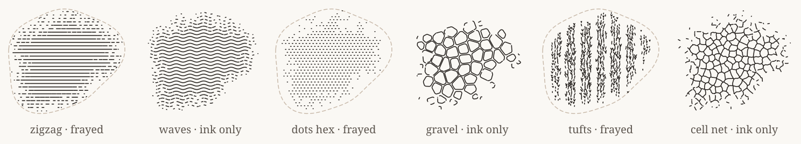

Setting `fray > 0.0` (in millimetres) creates a smooth disappearing transition over a band of width `fray` inside the region's perimeter. A Perlin-modulated survival ramp $w(p) \in [0, 1]$ rises from $0$ at the boundary to $1$ at depth `fray` inside the shape, and [`fray_strokes`](src/fray.rs) automatically adapts to three geometric classes:

1. **Continuous polylines and flow lines** (`zigzag`, `rectilinear`, `grid`, `waves`, `wood`, `marble`, `swells`, `eddies`, `hilbert`): Deep inside ($w \ge 0.88$) lines stay unbroken; in the mid-band ($0.30 \le w < 0.88$) lines break into progressively shorter dashes with widening gaps; near the outer edge ($0.10 \le w < 0.30$) dashes collapse into brief stipple ticks before vanishing ($w < 0.10$).
2. **Discrete marks and botanical motifs** (`dots`, `stipple`, `tufts`, `twigs`, `leaves`, `granite`, `diorite`): Whole marks are stochastically thinned out as $w \to 0$ and surviving marks shrink smoothly toward their midpoint or root instead of being chopped into fragments.
3. **Closed rings and cellular outlines** (`gravel`, `honeycomb`, `pebbles`, `canopy`, `cracks`): Cells shrink toward their centroid, stochastically drop out near the boundary, and break open into partial arcs in the outer fray zone.

See [`examples/gallery/fray.svg`](examples/gallery/fray.svg) for the full 12-pattern progression from `fray = 0 mm` to `fray = 9 mm` (both with a dashed boundary guide and as floating ink on paper).

### 2. Boundary modes (`EdgeMode`) and polygon masks (`FillOutput`)

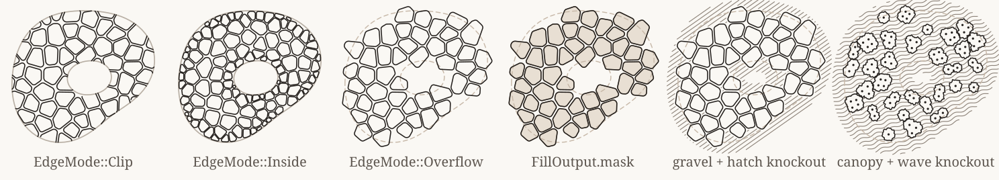

When filling regions with cellular, botanical, or organic motifs, you can control how elements interact with the boundary via `edge` ([`EdgeMode`](src/pattern.rs)):

- **`"clip"` (`EdgeMode::Clip`, default)**: Elements are generated up to the boundary and sliced cleanly along the region wall.
- **`"inside"` (`EdgeMode::Inside`)**: Discrete elements (Voronoi stones, pebbles, canopies, isoline stacks, twigs, tufts) are kept **strictly whole** inside the region — any element that would cross the wall is omitted or shrunk so no open cut edges appear.
- **`("overflow", margin_mm)` (`EdgeMode::Overflow(margin)`)**: Elements whose centres/roots lie inside `region` are allowed to protrude past the boundary by up to `margin` mm, giving organic foliage and stone clusters a natural silhouette.

### 3. Multi-layer knockouts with `FillOutput.mask`

Every fill can export a polygon **`mask: Region`** alongside its `strokes`:

- **Closed-element fills** (`gravel`, `terrazzo`, `cracks`, `pebbles`, `lily_pads`, `canopy`, `isoline_blobs`, `isoline_stack`) register their exact closed polygon rings into `mask` (automatically unioned and clipped to the active `EdgeMode` limit).
- **Line, mark, and frayed fills** compute an offset polygon halo around the emitted strokes (`Region::around_strokes(&strokes, halo)`), or return the effective region envelope when unfrayed.

Subtracting `fg.mask` (optionally outset by a small clearance like `0.3 mm`) from lower layers lets you stack foreground and background fills with zero overlapping pen lines:

```python
fg = penfill.gravel(island, 4.8, seed=7, edge=("overflow", 3.5), with_mask=True)
bg_region = backdrop.difference(fg.mask.outset(0.35))
bg_strokes = penfill.rectilinear(bg_region, 1.35, angle=35, anchor="global")
```

See [`examples/gallery/edges-and-masks.svg`](examples/gallery/edges-and-masks.svg) for side-by-side comparisons across `canopy`, `gravel`, `isoline_stack`, `lily_pads`, and frayed `tufts`.

---

## Lines and space-filling paths

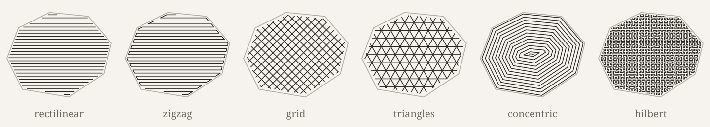

Scanline hatches (`rectilinear`, `zigzag`, `lines`, `grid`, `triangles`) use a direct active-edge sweep (`src/sweep.rs`), while `concentric`, `spiral`, and `hilbert` are built from polygon offsets and space-filling curves. All accept `inset`, `edge`, `fray`, `anchor`, and `with_mask`.

| Function | What it draws |
| --- | --- |
| `zigzag(region, spacing, angle=0, inset=None, fray=0)` | Serpentine hatch joined by short turns along the outline or hops across shallow concavities |
| `rectilinear(region, spacing, angle=0, inset=None, fray=0)` | Parallel hatch after wall inset (`spacing / 2` by default), one stroke per segment |
| `lines(region, spacing, angle=0, inset=None, fray=0)` | Single-direction scanline hatch running right up to the walls |
| `grid(region, spacing, angle=0, inset=None, fray=0)` | Two orthogonal hatches at `angle` and `angle + 90°` |
| `triangles(region, spacing, angle=0, inset=None, fray=0)` | Three hatches at 60° intervals meeting at shared lattice vertices |
| `concentric(region, spacing, inset=None, fray=0)` | Successive inward offset rings plus a medial-axis centreline in narrow necks |
| `spiral(region, spacing, inset=None, fray=0)` | Concentric offset rings linked into a single continuous inward path per lobe |
| `hilbert(region, spacing, inset=None, fray=0)` | Space-filling Hilbert curve visiting the interior cell by cell |

---

## Lattices and waves

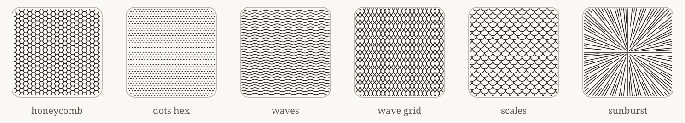

Regular geometric lattices placed via `anchor` (`"local"` or `"global"`) and clipped or frayed at the region perimeter.

| Function | What it draws |
| --- | --- |
| `honeycomb(region, spacing, angle=0, line_width=0, fray=0)` | Hexagonal cell walls, each shared edge drawn once (`line_width > 0` insets each hex cell) |
| `dots(region, spacing, angle=0, mark=None, lattice="square", fray=0)` | Short ticks on a `"square"` or `"hex"` lattice |
| `waves(region, spacing, angle=0, fray=0)` | Parallel sinusoidal waves |
| `wave_grid(region, spacing, angle=0, fray=0)` | Ogee lattice: mirrored sine waves meeting to form curved diamonds |
| `scales(region, spacing, angle=0, fray=0)` | Staggered rows of semicircular scale arcs, one continuous stroke per row |
| `sunburst(region, spacing, angle=0, centre=None, fray=0)` | Radial rays from `centre` (or shape centroid), subdividing outward to maintain ~`spacing` pitch |

---

## Scatter and nature

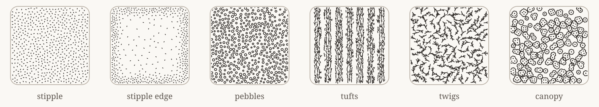

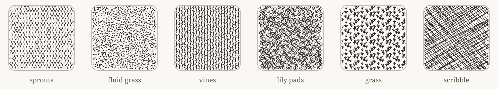

Stochastic and botanical patterns built on Bridson's Poisson-disk sampler (`src/stipple.rs`), Perlin vector fields, and `Canvas` + `Tools`.

| Function | What it draws |
| --- | --- |
| `stipple(region, spacing, mark=None, seed=0, fray=0)` | Evenly spaced Poisson-disk ticks (`mark` defaults to `0.3 × spacing`) |
| `stipple_noise(region, dense, sparse, mark=None, feature=12, seed=0, fray=0)` | Poisson stipple whose local spacing varies smoothly with Perlin noise |
| `stipple_edge(region, dense, sparse, mark=None, falloff=8, rough=0.5, seed=0, fray=0)` | Dense along the perimeter (`dense` mm), thinning inward over `falloff` mm (`sparse` mm) |
| `stipple_field(region, dense, sparse, field, mark=None, seed=0, fray=0)` | Custom density field `field(x, y) -> [0, 1]` (works whether `dense < sparse` or `dense > sparse`) |
| `pebbles(region, spacing, seed=0, edge="clip", fray=0)` | Smooth rounded pebble rings on a Poisson grid |
| `leaves(region, spacing, seed=0, edge="clip", fray=0)` | Staggered rows of curved blades and V-sprouts (also aliased as `sprouts`) |
| `fluid_grass(region, spacing, seed=0, edge="clip", fray=0)` | Single blades, V-tufts, and 3-blade fans aligned to a smooth Perlin vector field |
| `tufts(region, spacing, angle=0, seed=0, edge="clip", fray=0)` | Organic bands of 1- and 2-blade grass tufts with motif-level border thinning |
| `twigs(region, spacing, seed=0, edge="clip", fray=0)` | Scattered branched twigs with kinked 3–4 segment spines and acute side shoots |
| `vines(region, spacing, angle=90, seed=0, edge="clip", fray=0)` | Parallel meandering stems with alternating side-shoots |
| `lily_pads(region, spacing, seed=0, edge="clip", fray=0)` | Circular pads with centre dots; overlapping pads boolean-union into merged outlines |
| `canopy(region, spacing, seed=0, edge="clip", fray=0)` | Top-down tree canopies: clustered wobbly lobes with interior stipple dots |
| `grass(region, spacing, angle=0, seed=0, fray=0)` | Repeating 4×4 hatch tile of 3-blade grass tufts |
| `scribble(region, spacing, angle=0, seed=0, fray=0)` | Hand-drawn cross-hatching with jittered, broken strokes |

---

## Materials, flow, and cellular textures

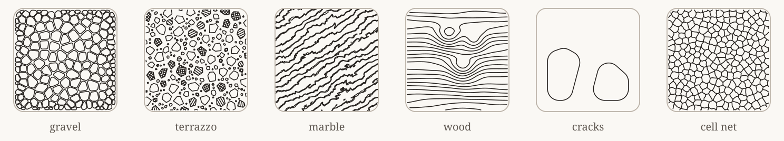

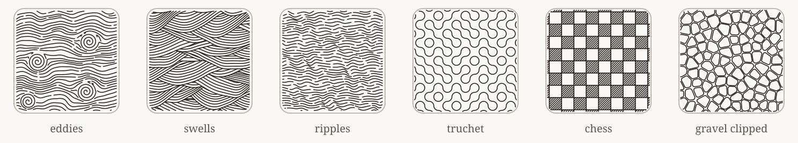

Cellular Voronoi tessellations, Jobard–Lefer streamline integration, horizon-occluded wave hills, and domain-warped contour textures.

| Function | What it draws |
| --- | --- |
| `gravel(region, spacing, seed=0, clipped=False, edge="inside", fray=0)` | Rounded Voronoi stones that shrink near the wall to fit corners (`clipped=True` cuts uniform stones) |
| `terrazzo(region, size, hatch=None, seed=0, edge="clip", fray=0)` | Non-overlapping angular chips across a wide size range; ~1/3 are hatched at `hatch` mm |
| `marble(region, spacing, angle=0, seed=0, fray=0)` | Domain-warped turbulent veins drawn as paired edge contours |
| `wood(region, spacing, angle=0, seed=0, fray=0)` | Grain lines flowing and bending around randomly placed interior knots |
| `cracks(region, spacing, seed=0, edge="clip", fray=0)` | Parched ground: rounded Voronoi cells with wide grout channels |
| `cell_net(region, spacing, seed=0, edge="clip", fray=0)` | Single-line Voronoi crack network where shared walls are drawn once with subtle angular kinks |
| `eddies(region, spacing, angle=0, seed=0, fray=0)` | Continuous streamlines integrated through an undulating current + vortex field (Jobard–Lefer placement) |
| `swells(region, spacing, angle=0, seed=0, fray=0)` | Overlapping wave hills rendered front-to-back with horizon occlusion and fanning contour ribs |
| `ripples(region, spacing, angle=0, seed=0, fray=0)` | Broken undulating wave strokes sharing a smooth 2D swell phase field |
| `truchet(region, cell, angle=0, seed=0, fray=0)` | Random quarter-circle Smiths tiles joining into long winding paths |
| `chess(region, cell, spacing=None, angle=0, fray=0)` | Checkerboard lattice with dark squares outlined and hatched |

---

## Organic contours and differential growth

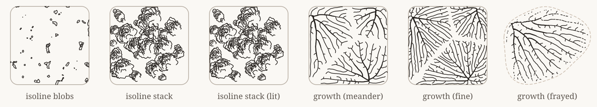

Multi-scale organic topography and biological curve growth (`src/isoline_blobs.rs`, `src/isoline_stack.rs`, `src/growth.rs`).

| Function | What it draws |
| --- | --- |
| `isoline_blobs(region, spacing, ring_spacing=None, seed=0, edge="clip", fray=0)` | Scattered organic blobs filled with nested eccentric contour rings; exports exact blob `mask` |
| `isoline_stack(region, crown=6.0, bubble=2.0, step=0.6, coverage=0.65, seed=0, edge="inside", fray=0)` | Occluding metaball clusters with concentric contour stacks and optional directional lighting (`Light`) |
| `growth(region, spacing=1.2, seed=0, edge="clip", fray=0)` | Differential-growth meandering and branching curves driven by repulsion, attraction, and curvature springs |

---

## Geology and ground textures

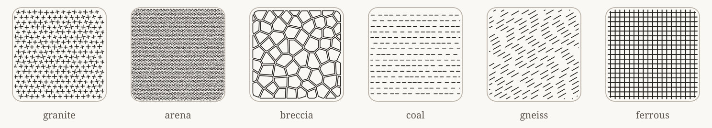

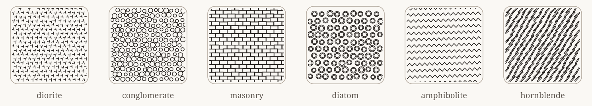

53 cartographic rock and soil hatches (`src/litho.rs`), built on deterministic cell-seeded lattices (`Tools::grid`) and Voronoi primitives. Every lithology can be called directly (`penfill.granite(...)`) or by name (`penfill.fill(region, "granite", spacing=2.5, fray=6.0)`), and all support `inset`, `edge`, `fray`, and `with_mask`.

| Igneous | Clastic | Bedded | Organic | Metamorphic / Special |
| --- | --- | --- | --- | --- |
| `granite` (`+` marks) | `arena` (fine dots) | `beds` (wavy horizons) | `diatom` (ring + dot) | `gneiss` (foliation dashes) |
| `granite2` (`×` grain) | `conglomerate` (round pebbles) | `laminae` (fine waves) | `diatom2` (denser rings) | `benton` / `bentonite` (dash columns) |
| `diorite` (`T` marks) | `conglomerate2` (flat pebbles) | `coal` (dashed seams) | `coquina` (shell spirals) | `amphibolite` (vertical zigzag) |
| `gabbro` (`V` marks) | `breccia` (angular clasts) | `masonry` (running bond) | | `ferrous` (ironstone check) |
| `brackets` (`└ ┘` marks) | `breccia2` (rounded clasts) | `sandstone` (dots + beds) | | `lava` (columnar bars) |
| `dacite` (crystal dashes) | `shards` (volcanic shards) | | | `hornblende` (crystal capsules) |
| `feldspar` (dense strokes) | `drift` (tilted pebbles) | | | `diabase` (dense hatch) |
| | `sand` (dense fine grain) | | | `ophitic` (laths + pyroxene) |
| | | | | `fill` (woven cross-hatch) |

### Ground, soil, and weathered surfaces

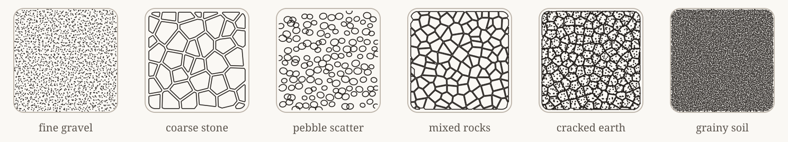

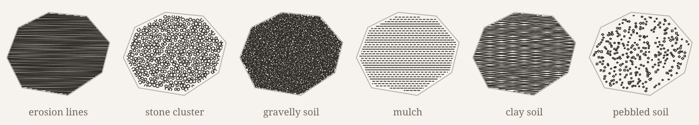

| Coarse / Stony | Cracked / Cellular | Layered / Wavy | Granular / Mulched |
| --- | --- | --- | --- |
| `fine_gravel` (dots + rings) | `cracked_earth` (cells + grain) | `erosion` (fine parallel waves) | `grainy_soil` (dense fine dots) |
| `coarse_stone` (grained blocks) | `dry_cracked` (mud cracks) | `layered_soil` (stacked horizons) | `gravelly_soil` (scattered dashes) |
| `pebble_scatter` (spaced ovals) | `silty_soil` (tight silt cells) | `clay_soil` (broad smooth waves) | `mulch` (staggered dashes) |
| `mixed_rocks` (varied stone cells) | `chalky_soil` (dots + open net) | `compacted_soil` (tight waves) | `mulched_soil` (finer dash rows) |
| `stone_cluster` (packed pebbles) | `debris_soil` (chips + specks) | | `topsoil` (3-size dot grain) |
| `pebbled_soil` (squares/diamonds) | | | `loose_soil` (open rings + dots) |
| | | | `sandy_soil` (fine sandy grain) |

---

## CAD hatch patterns

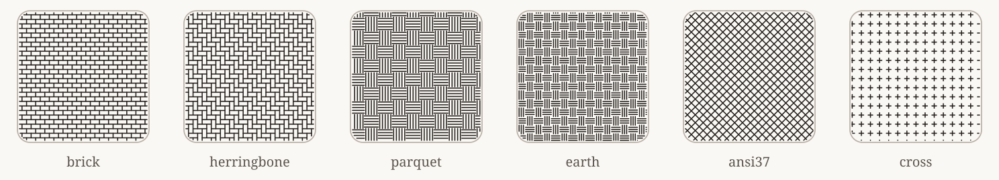

`penfill` parses standard AutoCAD / LibreCAD / QCAD `.pat` files and ships with 14 built-in definitions: `BRICK`, `HERRINGBONE`, `BASKET`, `PARQUET`, `ANSI31`, `ANSI32`, `ANSI33`, `ANSI37`, `EARTH`, `CROSS`, `DASH`, `STAIRS`, `GRATE`, `ANGLE`.

```python
bricks = penfill.pat(shape, "BRICK", scale=1.6, fray=6.0)

source = open("acad.pat").read()
print(penfill.pat_names(source))
custom_pat = penfill.pat(shape, "AR-PARQ1", scale=0.5, source=source)
```

---

## Pictures: dithering

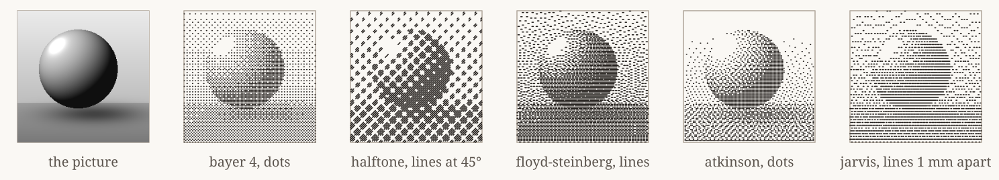

`dither` places an image over `region` and converts tone into plotter strokes on a grid of `resolution × line_spacing` mm cells rotated by `angle`:

- **`marks="lines"`** (default): Connects adjacent dark cells along each scanline into serpentine strokes for fast plotting.
- **`marks="dots"`**: Emits a short tick on each dark cell.
- **`method`**: `"threshold"`, `"random"`, `"bayer2"` … `"bayer16"`, `"halftone2"` … `"halftone16"`, `"floyd-steinberg"` (default), `"atkinson"`, `"jarvis"`, `"stucki"`, `"sierra"`.

### Placing a picture or SVG: `size`, `position`, `repeat`

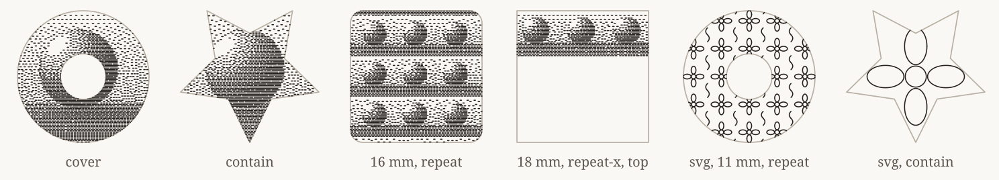

Both `dither` and `svg_fill` accept CSS-style placement options measured against the region's bounding box:

- **`size`**: `"cover"`, `"contain"`, `"fill"`, a width in mm (`14`, `"14mm"`, `"50%"`), or width and height (`"20 auto"`, `(40, 10)`).
- **`position`**: `"center"`, `"top left"`, `"bottom"`, `"25% 75%"`, `"5 10"`.
- **`repeat`**: `"no-repeat"` (default), `"repeat"`, `"repeat-x"`, `"repeat-y"`.

---

## Build your own pattern

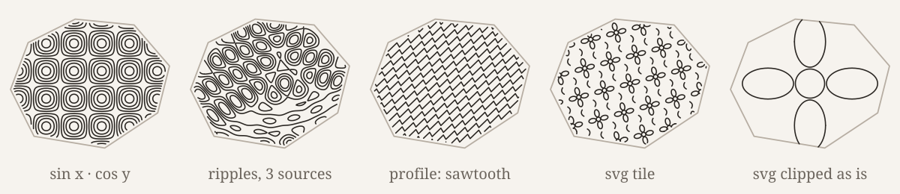

Every built-in pattern in `penfill` is written against the same [`Canvas`](src/pattern.rs) and [`Tools`](src/pattern.rs) contract exposed by `pattern` / `fill_pattern_output`. When you write a custom pattern function, the engine:
1. Applies `inset` and resolves `canvas.limit` according to `edge` (`Clip`, `Inside`, or `Overflow(margin)`),
2. Binds `Canvas` and `Tools` to the region, seed, spacing, angle, anchor, edge mode, and fray width,
3. Runs your callback to collect `Strokes` (and any semantic mask polygons registered via `tools.add_mask_ring` / `tools.add_mask`),
4. Clips the strokes to `canvas.limit`, applies universal perimeter fraying if `fray > 0` (unless your pattern called `tools.claim_fray()`), and builds the `FillOutput.mask` polygon region.

### `Canvas` reference

| Property / Method | Rust | Python / Node | Description |
| --- | --- | --- | --- |
| `region` | `canvas.region` | `canvas.region` | Target `Region` (after `inset`) |
| `limit` | `&canvas.limit` | `canvas.limit` | Clipping envelope (`region` for `Clip`/`Inside`, `region.outset(m)` for `Overflow(m)`) |
| `bounds` | `canvas.bounds` | `canvas.bounds` | `(min_x, min_y, max_x, max_y)` in mm |
| `origin` | `canvas.origin` | `canvas.origin` | Resolved anchor point `(x, y)` in mm |
| `spacing`, `angle`, `seed`, `fray` | `canvas.spacing`, … | `canvas.spacing`, … | Active fill parameters |
| `edge` | `canvas.edge` | `canvas.edge` | Active `EdgeMode` (`"clip"`, `"inside"`, `"overflow"`) |
| `accept_ring(ring)` | `canvas.accept_ring(&ring)` | `canvas.accept_ring(ring)` | `true` if `ring` satisfies `EdgeMode` (`covers_ring` for `Inside`, intersects `region` otherwise) |

### `Tools` standard library reference

| Category | Method | What it provides |
| --- | --- | --- |
| **RNG & Noise** | `rng()`, `rng_salted(salt)`, `cell_rng(i, j)` | Deterministic `SplitMix64` RNG streams (global-anchor safe per cell `(i, j)`) |
| | `noise(x, y, octaves=1)` | Multi-octave Perlin fBm in `[-1, 1]` |
| | `curl(x, y, eps=0.01)` | Divergence-free 2D velocity vector `(vx, vy)` from Perlin potential |
| **Frames & Lattices** | `frame(angle)` | Anchored coordinate `Frame` (`world(uv)`, `local(xy)`, `span(region, pad)`) |
| | `grid(dx, dy, angle, row_shift, jitter, f)` | Iterates lattice cells inside `region` with deterministic per-cell RNG |
| | `grid_cells(dx, dy, angle, row_shift, margin, f)` | Iterates all lattice cells across `limit + margin` |
| **Sampling & Scanlines** | `scatter(spacing)`, `scatter_in(region, spacing)` | Bridson Poisson-disk points |
| | `scatter_field(dense, sparse, field)` | Variable-density Poisson-disk points driven by `field(x, y) -> [0, 1]` |
| | `hatch(spacing, angle=0)` | Anchored scanline hatch clipped to `region` |
| | `isolines(cell, levels, f)` | Marching-squares contour lines of scalar field `f(x, y)` |
| | `profile(spacing, angle, f)` | Parallel lines bent by 1D wave function `f(x)` |
| **Voronoi & Cells** | `voronoi_cells(sites, max_radius)` | Exact half-plane clipped Voronoi cells `Vec<(site_idx, site_pt, ring)>` |
| | `voronoi_edges(sites, max_radius)` | Deduplicated shared Voronoi edges `Vec<(i, j, pt_a, pt_b)>` (each wall once) |
| **Shapes & Curves** | `circle(c, r)`, `lobe(c, r, phase, rough)`, `arc(c, r, a0, a1, steps)` | Closed rings, organic foliage lobes, and circular arcs |
| | `tick(c, angle, half)`, `cross(c, half, twist)`, `x_cross(c, half, twist)` | Centred crystal/stipple marks |
| | `smooth(ring, passes)`, `catmull_rom(pts, tension, subdivs)`, `resample(pts, step)` | Chaikin corner cutting, cardinal splines, and uniform arc-length resampling |
| **Boundary & Fray** | `border_ramp(pt, falloff, rough)` | Noisy `[0, 1]` distance ramp (`0` at wall, `1` at depth `falloff` mm) |
| | `whole_at(pt)` | Smooth `[0, 1]` survival weight inside the active `fray` band |
| | `element_fits(center, radius)` | Checks whether a motif of `radius` at `center` satisfies `EdgeMode` |
| | `claim_fray()` | Marks that the pattern handles `fray` at the motif level (skips post-pass stroke chopping) |
| **Masks & Scoping** | `add_mask_ring(ring)`, `add_mask(region)`, `set_mask_halo(r)` | Contributes closed silhouettes or regions to `FillOutput.mask` |
| | `on(region)`, `seeded(salt)`, `with_spacing(s)`, `with_edge(e)`, `with_fray(f)` | Scoped `Tools` clones for sub-regions or multi-layer patterns |

### Example: Writing a custom Voronoi stone pattern with `EdgeMode`, `fray`, and `mask`

**Python**

```python
import penfill

def my_stones(canvas, tools):
    strokes = []
    for idx, center, ring in tools.voronoi_cells(tools.scatter(canvas.spacing), canvas.spacing * 1.8):
        if not canvas.accept_ring(ring):
            continue
        smooth_ring = tools.smooth(ring, passes=2)
        tools.add_mask_ring(smooth_ring)
        strokes.append(smooth_ring)
    return strokes

out = penfill.pattern(
    shape,
    my_stones,
    spacing=4.0,
    seed=7,
    edge="inside",
    fray=6.0,
    with_mask=True,
)
```

**Rust**

```rust
use penfill::{fill_pattern_output, EdgeMode, FillParams};

let params = FillParams::new(4.0).seed(7).edge(EdgeMode::Inside).fray(6.0);
let out = fill_pattern_output(&shape, &params, |canvas, tools| {
    let sites = tools.scatter(canvas.spacing);
    let mut strokes = Vec::new();
    for (_, _, ring) in tools.voronoi_cells(&sites, canvas.spacing * 1.8) {
        if !canvas.accept_ring(&ring) {
            continue;
        }
        let smooth = tools.smooth(&ring, 2);
        tools.add_mask_ring(&smooth);
        strokes.push(smooth);
    }
    strokes
});
```

---

## Any shape & Gallery reference

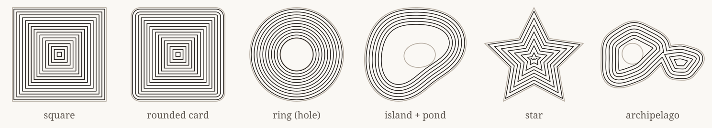

Holes, concave bays, sharp corners, and multi-polygon archipelagos are handled automatically across every fill.

### SVG Gallery (`examples/gallery/`)

Running `cargo run --release --example gallery` generates the complete vector reference suite in [`examples/gallery/`](examples/gallery):

- **[`gallery.svg`](examples/gallery/gallery.svg)**: Categorized visual reference poster showing all 94 built-in patterns grouped by family, each rendered side-by-side on a crisp square and on a frayed organic contour (`fray = 8.5 mm`).
- **[`all-patterns.svg`](examples/gallery/all-patterns.svg)**: Compact alphabetical index grid of all 94 patterns.
- **[`fray.svg`](examples/gallery/fray.svg)**: Universal edge fraying progression (`0 mm` → `4.5 mm` → `9.0 mm` with guide → `9.0 mm` ink only) across lines, waves, discrete marks, botanicals, and Voronoi cells.
- **[`edges-and-masks.svg`](examples/gallery/edges-and-masks.svg)**: Side-by-side showcase of `EdgeMode::Clip`, `EdgeMode::Inside`, `EdgeMode::Overflow(3.5)`, `FillOutput.mask`, and multi-layer background knockouts (`below.difference(&out.mask)`).
- **Per-pattern sheets (`examples/gallery/<slug>.svg`)**: One SVG per pattern showing 3 density/angle rows across 4 columns (`square (unfrayed)`, `ring + hole (unfrayed)`, `frayed (with guide)`, and `frayed (ink only)`).
- **[`cad.svg`](examples/gallery/cad.svg), [`custom.svg`](examples/gallery/custom.svg), [`dither.svg`](examples/gallery/dither.svg), [`placement.svg`](examples/gallery/placement.svg)**: Dedicated sheets for `.pat` hatches, custom functions, dithering algorithms, and CSS-style placement.

---

## Development

```
src/                 Rust core crate (`penfill`)
bindings/python/     PyO3 module (`penfill-python`), built with maturin
bindings/node/       napi-rs addon (`penfill-node`)
bindings/wasm/       wasm-bindgen crate (`penfill-wasm`) for the web playground
examples/gallery.rs  Generates `examples/gallery/*.svg` and `docs/img/*.svg`
docs/architecture/   Subsystem architecture documentation (start at INDEX.md)
```

```sh
cargo test --package penfill                           # run all unit + doc tests
cargo run --release --example gallery                  # regenerate gallery + README SVGs

cd bindings/python && maturin develop --release && pytest
cd bindings/node && npm install && npm run build && npm test
```

### Browser playground (WebAssembly)

```sh
./scripts/build-wasm.sh
cd web && npm install && npm run dev
```

## License

Licensed under either of [MIT](LICENSE-MIT) or [Apache-2.0](LICENSE-APACHE), at your option.
