# penfill

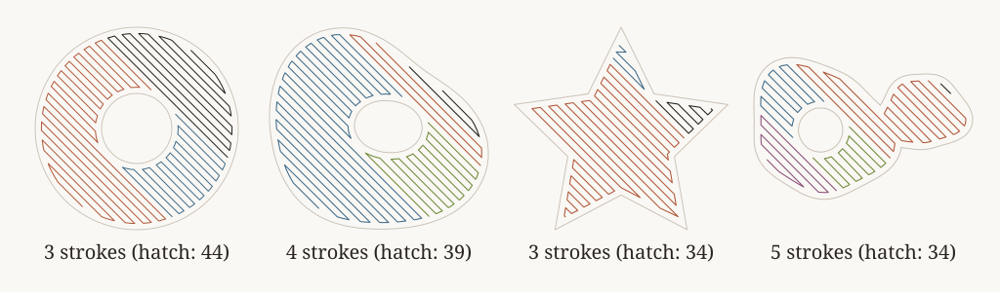

**Infill, hatching, and generative texture engine for pen plotters, CNC toolpaths, and laser engravers — in Rust, Python, Node.js, and WebAssembly.**

Give `penfill` a polygon region in millimetres and it returns the open polylines (`Strokes`) a pen should draw to fill it: serpentine hatches that barely lift the pen, offset rings and spirals, lattices and tilings, stipple, Voronoi stones and mud cracks, flowing water, tree crowns and clouds seen from above, the rock symbols of geological maps, AutoCAD `.pat` hatches, dithered images, and patterns you write yourself.

The patterns are a **catalogue** in two layers:

- **Generators** are the algorithms: a couple of dozen ways to put lines in an area (`hatch`, `scatter`, `cells`, `tile`, `waves`, `rings`, …). Each one takes the same shared vocabulary (`spacing`, `angle`, `seed`, `density`, …) plus options of its own, and **describes itself**: every option has a kind, a default and a sentence of documentation, so a typo is an error that names the valid keys, and a host can build its reference from the data.
- **Materials** are named recipes over generators — `gravel`, `marsh`, `limestone`, `herringbone`, `clouds` — grouped by what they are for (water, vegetation, ground, rock, built, sky, plain hatches). Most of the time you pick a material; when you want something it doesn't do, drop to its generator and set every option.

Every pattern clips to the region and goes around its holes, and supports **perimeter fraying (`fray`)**, **boundary modes (`edge`: `Clip`, `Inside`, `Overflow`)**, **global anchoring** so neighbouring shapes meet without a seam, and **polygon knockout masks (`FillOutput { strokes, mask }`)** for layered compositions.

## Install

```sh
pip install penfill       # Python ≥ 3.9
npm install penfill       # Node ≥ 18, TypeScript types included
cargo add penfill         # Rust
```

The core engine is pure Rust (`i_overlay` boolean geometry, a `SplitMix64` RNG, and Perlin noise with no platform drift). Python, Node, and Rust produce identical strokes for the same seed.

## Quick start

**Rust** — the catalogue is `penfill::catalog`: a name, a region, and a [`Spec`](src/catalog/mod.rs).

```rust
use penfill::catalog::{self, Spec};
use penfill::{Anchor, EdgeMode, Region};

let outer = vec![(0.0, 0.0), (80.0, 0.0), (80.0, 60.0), (0.0, 60.0)];
let hole = vec![(30.0, 20.0), (50.0, 20.0), (50.0, 40.0), (30.0, 40.0)];
let shape = Region::from_polygons(&[vec![outer, hole]]);

// A material, at its own spacing.
let gravel = catalog::fill("gravel", &shape, &Spec::default()).unwrap();

// The same material twice as coarse (spacing scales the whole recipe),
// fading out over 8 mm at the edge.
let coarse = catalog::fill("gravel", &shape, &Spec::default().spacing(3.2).fray(8.0).seed(7)).unwrap();

// A generator, with options of its own: reeds, denser toward the shore.
let reeds = catalog::fill(
    "scatter",
    &shape,
    &Spec::default().spacing(2.0).option("motif", "reed").option("rotate", "upright").option("density", "edge"),
)
.unwrap();

// Trees over a hatch: the hatch stops where the trees are.
let trees = catalog::fill_output("woodland", &shape, &Spec::default().edge(EdgeMode::Overflow(1.0))).unwrap();
let below = shape.difference(&trees.mask.outset(0.3));
let hatch = catalog::fill("lines", &below, &Spec::default().angle(35.0).anchor(Anchor::GLOBAL)).unwrap();
```

A mistake says what to write instead:

```text
catalog::fill("gravle", …)                       unknown pattern "gravle"; did you mean "grate" or "gravel"?
catalog::fill("hatch", … .option("crosss", 2.0))  hatch has no option "crosss"; it takes cross, join, dash, dash_jitter, wobble, wobble_length, vary, density, contrast, feature, toward
```

**Python**

```python
import penfill

outer = [(0, 0), (80, 0), (80, 60), (0, 60)]
hole  = [(30, 20), (50, 20), (50, 40), (30, 40)]
shape = penfill.Region(outer, holes=[hole])

# Any catalogue name: a material or a generator.
strokes = penfill.fill(shape, "serpentine", 1.2, angle=45)

# Fading out over 8 mm at the edge.
frayed = penfill.fill(shape, "gravel", 2.0, fray=8.0, seed=7)

# Numeric options of the generator go in `custom`.
grid = penfill.fill(shape, "hatch", 0.8, custom={"cross": 2})

# Multi-layer knockout: the canopy masks out the hatching below it.
fg = penfill.fill_output(shape, "canopy", 6.0, seed=7, edge=("overflow", 3.0))
bg = penfill.lines(shape.difference(fg.mask.outset(0.4)), 1.2, angle=35)

open("plot.svg", "w").write(penfill.to_svg(fg.strokes + bg, outline=shape))
```

**Node.js**

```js
import { Region, fill, fillOutput, lines, toSvg } from 'penfill'
import { writeFileSync } from 'node:fs'

const shape = new Region(
  [[0, 0], [80, 0], [80, 60], [0, 60]],
  [[[30, 20], [50, 20], [50, 40], [30, 40]]],
)

const strokes = fill(shape, 'serpentine', 1.2, { angle: 45 })
const frayed  = fill(shape, 'gravel', 2.0, { fray: 8, seed: 7 })
const grid    = fill(shape, 'hatch', 0.8, { custom: { cross: 2 } })

const fg = fillOutput(shape, 'canopy', 6.0, { seed: 7, edge: 'overflow', overflow: 3 })
const bg = lines(shape.difference(fg.mask.outset(0.4)), 1.2, { angle: 35 })
writeFileSync('plot.svg', toSvg([...fg.strokes, ...bg], shape))
```

From Python and Node, `fill` / `fill_output` (`fillOutput`) reach every catalogue name, and `penfill.FILLS` / `fills()` list them. That path passes the standard parameters and **numeric** options only (`custom={"cross": 2}`); options that are words, lists or polylines (`motif`, `shape`, `dash`, `pat`, …) are reachable from Rust (`Spec::option`) for now. Two other differences from Rust: `spacing` defaults to 2 mm rather than the material's own, and a mistake comes back as `no fill named "…"` (an unknown custom key is ignored) instead of the catalogue's message.

---

## Contents

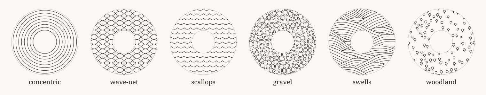

1. [How it works](#how-it-works)
2. [The catalogue](#the-catalogue): [shared vocabulary](#the-shared-vocabulary), [generators](#generators), [materials](#materials) ([water](#water), [vegetation](#vegetation), [ground](#ground-and-soil), [rock](#rock), [built](#built), [sky](#sky), [plain hatches](#plain-hatches)), [symbols](#symbols)
3. [Edge fraying, boundary modes, and polygon masks](#edge-fraying-boundary-modes-and-polygon-masks)
4. [CAD hatch patterns (`.pat`)](#cad-hatch-patterns)
5. [Pictures: dithering and placement](#pictures-dithering)
6. [Build your own pattern](#build-your-own-pattern)
7. [Any shape and the gallery](#any-shape-and-the-gallery)
8. [Development](#development)

---

## How it works

Every fill takes a **[`Region`](src/geo.rs)** and its parameters and returns **[`Strokes`](src/geo.rs)** (or a **[`FillOutput`](src/pattern.rs)** when you also want the mask).

- **`Region`**: an area in millimetres made of one or more outer rings, each with any number of holes. Build it with `Region(outer, holes=[...])` or `Region.from_polygons([[outer, hole, ...], ...])`. Regions support boolean operations (`union`, `intersection`, `difference`), offsetting (`inset`, `outset`), stroke buffering (`around_strokes(strokes, radius)`), queries (`contains`, `distance`, `parts`), and polyline clipping and fraying (`clip`, `fray`).
- **`Strokes`**: `Vec<Vec<(f64, f64)>>`, a list of open polylines in millimetres, in drawing order. Each polyline is one pen-down from its first point to its last.

The standard parameters mean the same thing on every pattern and in every language:

| Parameter | Rust (`Spec`) | Python | Node (`FillOptions`) | Meaning |
| --- | --- | --- | --- | --- |
| **`spacing`** | `.spacing(mm)` | `spacing` (after the name) | `spacing` (after the name) | Distance between neighbouring elements in mm. Unset (Rust only): the pattern's own |
| **`angle`** | `.angle(deg)` | `angle=0.0` | `{ angle: 0 }` | Rotation of the pattern (not the region) |
| **`seed`** | `.seed(u64)` | `seed=0` | `{ seed: 0 }` | Deterministic randomness |
| **`inset`** | `.inset(mm)` | `inset=None` | `{ inset: 0.8 }` | Wall margin applied before filling (unset: the pattern's default) |
| **`edge`** | `.edge(EdgeMode)` | `edge="clip"` | `{ edge: 'clip', overflow: 2.5 }` | How elements meet the boundary: `"clip"`, `"inside"`, or `("overflow", mm)` |
| **`fray`** | `.fray(mm)` | `fray=0.0` | `{ fray: 0 }` | Width of the band over which the fill fades out at the edge (`0` = hard edge) |
| **`anchor`** | `.anchor(Anchor)` | `anchor="local"`, `shift=(x, y)` | `{ anchor: 'local', shift: [x, y] }` | `"local"` centres the pattern on the shape; `"global"` locks it to the page origin, so adjacent shapes meet seamlessly |
| options | `.option(key, value)` | `custom={...}` (numbers) | `{ custom: {...} }` (numbers) | The generator's own options and the tone (see below) |
| mask | `catalog::fill_output` | `fill_output` / `with_mask=True` | `fillOutput` | Also return the polygon `mask` the fill covers |

---

## The catalogue

Everything below is generated from the catalogue itself: `catalog::describe()` returns every generator's options (key, kind, default, doc) and every material (group, description, spacing, layers) as JSON, and `cargo run --release --example catalog_sheet -- --json` prints it. Source: [`src/catalog/`](src/catalog), design notes in [`docs/architecture/catalog.md`](docs/architecture/catalog.md).

### The shared vocabulary

Every generator reads these the same way.

| Option | Meaning |
| --- | --- |
| `spacing` | Distance between neighbouring elements, centre to centre, in mm: line pitch, mark pitch, cell size. A material has its own default; giving one scales the whole material, which keeps its proportions. |
| `angle` | Rotation of the pattern in degrees. |
| `seed` | Deterministic randomness. |
| `anchor` | `local` (centred on the shape) or `global` (page origin: neighbouring areas meet without a seam). Every generator honours it, scatter included. |
| `inset`, `edge`, `fray` | The wall margin, how elements meet the boundary (`clip`, `inside` keeps marks whole, `overflow`), and the fade at the edge. |
| `mark` | The size of one element (a dot's length, a symbol's height), in mm. |
| `jitter` | 0–1: how far elements wander from their place. |
| `vary` | 0–1: how much element sizes (or line gaps) differ. |
| `density` | The tone across the area: `even` (default), `edge` (denser toward the boundary), `centre`, `noise` (patches), `gradient` (denser toward `toward` degrees), with `contrast` (0–1, how far the tone swings) and `feature` (mm, the size of the edge band or the noise patches). Generators that can thin follow it: scatter keeps fewer marks, hatch breaks lines and drops crossing layers like an engraving. |

Light comes from `light_angle` in page degrees (0 from the right, 90 from below), 225 by default: the map maker's top left.

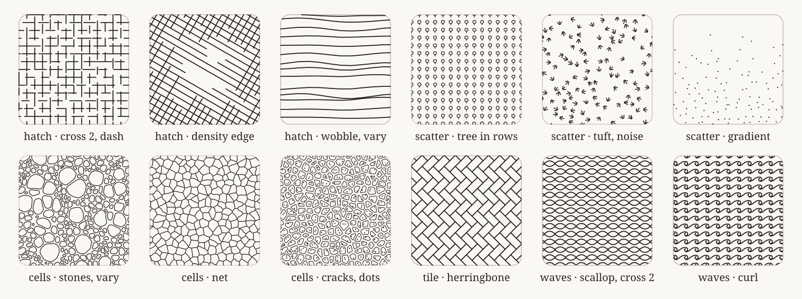

### Generators

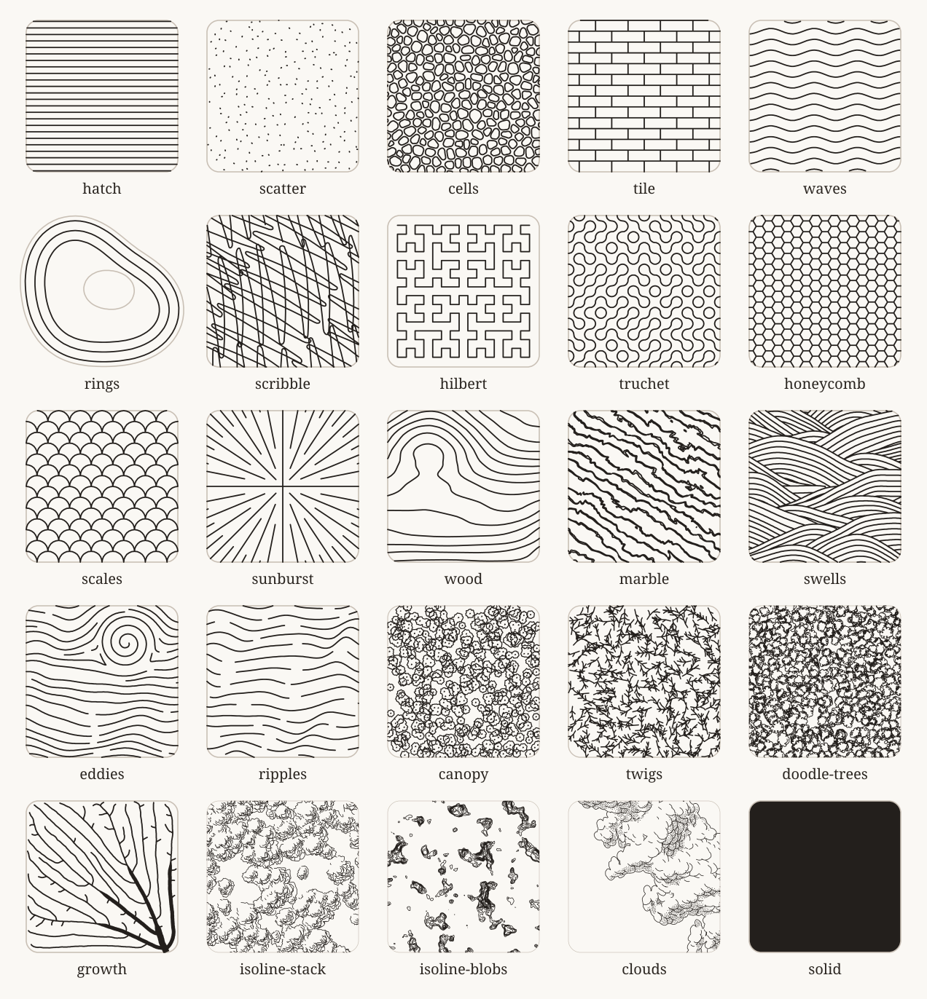

"Tone" is `density`, `contrast`, `feature` and `toward`, above.

| Generator | Draws | Its own options |
| --- | --- | --- |
| `hatch` | Parallel lines; crossed into a grid or a triad, joined into serpentines, dashed, bent, unevenly spaced, or thinned by tone. | `cross`, `join`, `dash`, `dash_jitter`, `wobble`, `wobble_length`, `vary` · tone |
| `scatter` | One mark at each of many places: dots, strokes, stones, plants or a symbol of your own, evenly scattered, on a lattice, in rows or in clusters, thinned by tone. | `arrange`, `motif`, `rotate`, `overlap`, `mark`, `vary`, `jitter` · tone |
| `cells` | Irregular cells: rounded stones apart from each other, a net of shared walls, or plates with wide cracks; with marks inside, sizes from even to mixed, thinned by tone. | `style`, `gap`, `round`, `inner`, `vary`, `jitter` · tone |
| `tile` | A motif laid on a lattice: brick, herringbone, basket weave, parquet, setts, flagstones, tiles, hexagons, stairs, grating, chess; your own polylines; or a CAD .pat hatch. | `motif`, `size`, `stagger`, `gap`, `pat`, `jitter` |
| `waves` | Wavy parallel lines: sine, scallops, zigzag teeth, curling crests or a flowing swell; doubled into a net with `cross: 2`. | `shape`, `wavelength`, `amplitude`, `cross`, `stagger`, `flip`, `round`, `curl`, `turns`, `drift`, `breaks` |
| `rings` | Rings from the boundary inward, a spacing apart: concentric with the outline, offset from every edge, or one continuous spiral. | `from`, `spiral` |
| `scribble` | Hand shading with a fine pen: loose zigzag strokes with rounded turns, in overlapping patches, layered at different angles. | `layers`, `loose`, `length` · tone |
| `hilbert` | One unbroken space-filling Hilbert curve visiting the whole area cell by cell; cells between half a spacing and a spacing. | the shared ones |
| `truchet` | Truchet tiles: square cells a spacing wide, each with two quarter arcs turned at random, chaining into long winding paths. | the shared ones |
| `honeycomb` | Hexagonal cells a spacing across (flat to flat), each wall drawn once, or doubled `walls` apart. | `walls` |
| `scales` | Fish scales: rows of half circles a spacing apart, each row resting on the tips of the one below; roof tiles and drawn water. | the shared ones |
| `sunburst` | Rays from a centre, about a spacing apart at every radius: new rays join in rings where the gaps open, so the centre never crowds. | `centre` |
| `wood` | Wood grain: long lines a spacing apart running along the angle, wandering slowly and flowing round knots. | `knots` |
| `marble` | Marble: veins about a spacing apart drifting across the slab at the angle, warped by turbulence, each drawn as its two edges so it pinches and swells. | the shared ones |
| `swells` | Overlapping swells or dunes: crest lines layered back to front, each hiding the ones behind and filled with lines that follow its slope. | the shared ones |
| `eddies` | Currents: evenly spaced streamlines of a flow that undulates and winds into spiral eddies. | the shared ones |
| `ripples` | Ripples: rows of broken wavy strokes a spacing apart, their crests bending together over a slow swell. | the shared ones |
| `canopy` | Tree canopies from above: clusters of wobbly lobes, a dot at each lobe's heart, trees a spacing apart. | the shared ones |
| `twigs` | Scattered twigs a spacing apart: a kinked stick with short side shoots at acute angles; brushwood, scrub, forest litter. | the shared ones |
| `doodle-trees` | Trees as a hand doodles them on a sketch map: each crown (a spacing across) one curly stroke round a lumpy circle, with a crescent of shade; nearer crowns hide those behind. | `coverage`, `loops`, `shadow`, `light_angle` |
| `growth` | Branches grown toward the space they have to fill (space colonisation): river deltas, veins, roots, cracks, lichen; twigs a spacing apart. | `roots`, `root_spacing`, `step`, `reach`, `kill`, `pen`, `trunk`, `coverage`, `variation`, `max_steps`, `jitter` |
| `isoline-stack` | Tree crowns drawn as stacked contour tiers, lit from one side; `spacing` is a crown's diameter, and the crowns are the mask. | `hatched`, `coverage`, `bubble`, `slices`, `jitter_period`, `ticks`, `elongation`, `lobes`, `light`, `light_angle`, `light_elevation`, `hatch`, `jitter` |
| `isoline-blobs` | Blobs a spacing apart, each filled with nested contour rings like a height map; the blobs are the mask. | `contour`, `warp`, `warp_period`, `threshold` |
| `clouds` | Cumulus seen from above: puffs a spacing across heaped on bodies that rise and fall, shaded away from the sun; the clouds are the mask. | `cell`, `coverage`, `warp`, `puffs`, `elongate`, `stretch`, `wind`, `light_angle`, `light_elevation`, `height`, `shade`, `hatch`, `shading`, `dot` |
| `solid` | A flat fill with no pen strokes: the host paints the area (an SVG fill, a screen preview); plotters draw nothing. Its mask is the whole area. | the shared ones |

Used by name, a generator draws at its own default spacing; `describe()` lists it, with every option's kind, default and documentation.

### Materials

Grouped in the order a map maker reaches for them. Rock follows the conventions of geological maps (sandstone dots, shale dashes, limestone in brick bond, granite crosses, volcanic vees), so it reads as the symbols a geologist expects. Each strip shows every material of its group at its own spacing.

#### Water

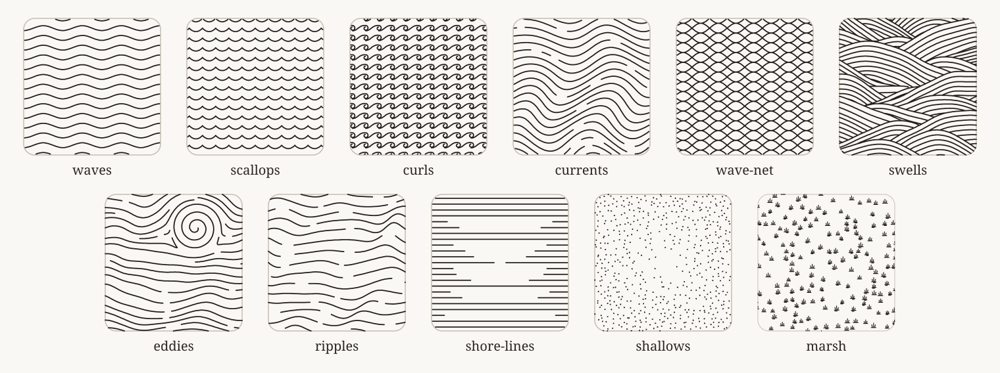

Seas, lakes, rivers and wet ground.

| Material | Spacing | Drawn with | What it is |
| --- | --- | --- | --- |
| `waves` | 1 mm | `waves` | Even sine waves: the classic water fill. |
| `scallops` | 1 mm | `waves` | Rows of scallops, arcs dipping between sharp points: a decorative sea. |
| `curls` | 1.2 mm | `waves` | Waves with curling crests, like an old chart's sea. |
| `currents` | 0.8 mm | `waves` | Long swell lines that bunch and spread without crossing, broken into strokes: open sea. |
| `wave-net` | 1.2 mm | `waves` | Two families of waves crossing into a net. |
| `swells` | 0.5 mm | `swells` | Overlapping swells, each a bundle of curves: a lively sea. |
| `eddies` | 0.8 mm | `eddies` | Flowing lines round small whirls. |
| `ripples` | 1 mm | `ripples` | Short broken ripple lines. |
| `shore-lines` | 0.6 mm | `hatch` | Engraved water lines, close along the shore and thinning out to open water. |
| `shallows` | 0.55 mm | `scatter` | Stipple dense along the shore, fading out to open water. |
| `marsh` | 3.2 mm | `scatter` | The marsh symbol: tufts of reeds over short water lines. |

#### Vegetation

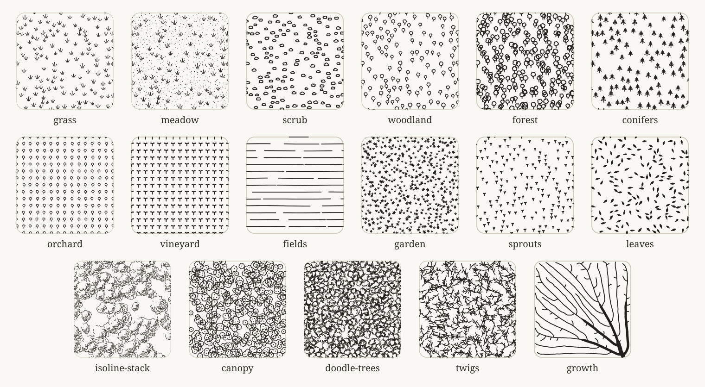

Grass, woods, crops and gardens, in the symbols maps use for them.

| Material | Spacing | Drawn with | What it is |
| --- | --- | --- | --- |
| `grass` | 3.2 mm | `scatter` | Scattered grass tufts. |
| `meadow` | 3 mm | `scatter` | Grass tufts in patches with seed dots between: rough grassland. |
| `scrub` | 1.6 mm | `scatter` | Low bushes scattered close: heath, scrub, brush. |
| `woodland` | 2.6 mm | `scatter` | The topographic woodland symbol: broadleaf trees standing apart. |
| `forest` | 2 mm | `scatter` | Broadleaf trees close enough to touch: dense forest. |
| `conifers` | 2.4 mm | `scatter` | The conifer symbol: narrow firs standing apart. |
| `orchard` | 3.2 mm | `scatter` | Trees planted in rows. |
| `vineyard` | 1.6 mm | `scatter` | Vines trained in close rows. |
| `fields` | 1 mm | `hatch` | Furrows: long broken rows, as ploughed land or crops are drawn. |
| `garden` | 3 mm | `scatter` | Flowers scattered over sparse grass. |
| `sprouts` | 2 mm | `scatter` | Seedlings, two leaves each: young crops, nurseries. |
| `leaves` | 1.8 mm | `scatter` | Fallen leaves turned every way: leaf litter, a woodland floor. |
| `isoline-stack` | 8 mm | `isoline-stack` | Tree crowns from above, as stacked contour slices with light and shade. |
| `canopy` | 3 mm | `canopy` | Lobed crowns packed together: a canopy seen from above. |
| `doodle-trees` | 4 mm | `doodle-trees` | Loose doodled crowns with a shade crescent. |
| `twigs` | 2.5 mm | `twigs` | Small branching twigs. |
| `growth` | 1 mm | `growth` | Branches grown toward the light: roots, veins, river deltas. |

#### Ground and soil

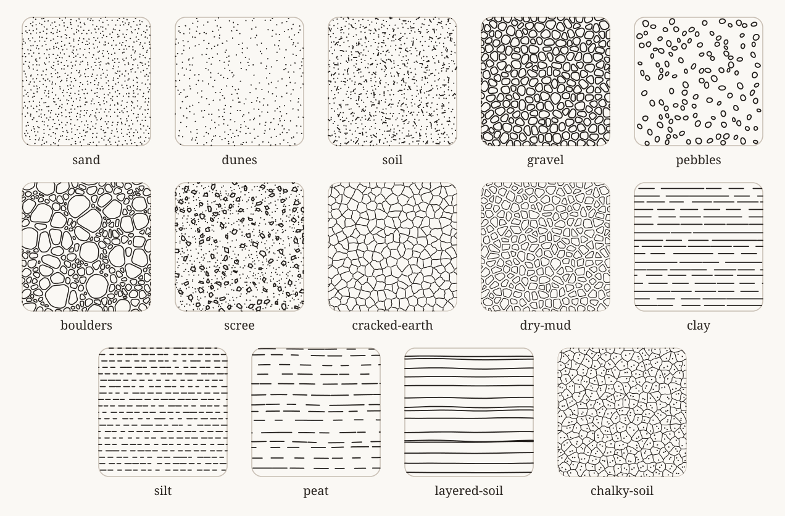

Sand, soil, gravel and bare earth.

| Material | Spacing | Drawn with | What it is |
| --- | --- | --- | --- |
| `sand` | 0.5 mm | `scatter` | Fine even stipple. |
| `dunes` | 0.5 mm | `scatter` | Stipple in drifts, dense and sparse: dunes, beaches, deserts. |
| `soil` | 1.2 mm | `scatter` | Grains and short ticks: bare soil, earth. |
| `gravel` | 1.6 mm | `cells` | Small rounded stones packed together. |
| `pebbles` | 2 mm | `scatter` | Pebbles lying apart, each its own outline. |
| `boulders` | 2.4 mm | `cells` | Rocks of every size, big boulders among small stones. |
| `scree` | 1.6 mm | `scatter` | Angular fragments and grit: scree, talus, broken rock. |
| `cracked-earth` | 3 mm | `cells` | A net of cracks seen from above: dried mud, salt flats. |
| `dry-mud` | 3.5 mm | `cells` | Mud dried into rounded plates with wide cracks between. |
| `clay` | 0.8 mm | `hatch` | Long dashes in uneven rows: clay, alluvium. |
| `silt` | 0.7 mm | `hatch` | Short fine dashes: silt, loess. |
| `peat` | 1 mm | `hatch` | Broken wavering dashes: peat, bog, organic soil. |
| `layered-soil` | 0.9 mm | `hatch` | Uneven bands that bend together: a soil profile, sediment in section. |
| `chalky-soil` | 3.5 mm | `cells` | A net of cells with grains inside: chalky or stony soil. |

#### Rock

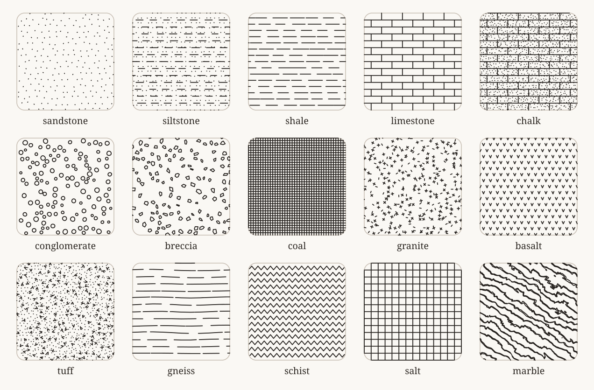

Rock in the conventions of geological maps: the symbols a geologist reads at a glance.

| Material | Spacing | Drawn with | What it is |
| --- | --- | --- | --- |
| `sandstone` | 1 mm | `scatter` | Even dots: sandstone, in the geologist's convention. |
| `siltstone` | 1.4 mm | `hatch` + `scatter` | Rows of dashes with dots between: siltstone. |
| `shale` | 0.9 mm | `hatch` | Rows of dashes: shale, mudstone. |
| `limestone` | 1.4 mm | `tile` | Blocks in brick bond: limestone. |
| `chalk` | 2 mm | `tile` + `scatter` | Wide blocks with fine grains: chalk. |
| `conglomerate` | 1.8 mm | `scatter` | Rounded pebbles of every size: conglomerate. |
| `breccia` | 1.8 mm | `scatter` | Angular fragments: breccia. |
| `coal` | 0.35 mm | `hatch` | Inked solid by a close crosshatch: coal seams. |
| `granite` | 1.6 mm | `scatter` | Crosses and ticks scattered every way: granite and other intrusive rock. |
| `basalt` | 1.6 mm | `scatter` | Vees in rows: basalt and other volcanic rock. |
| `tuff` | 1.6 mm | `scatter` | Vees every way with grains between: tuff, volcanic ash. |
| `gneiss` | 1.1 mm | `hatch` | Long wavering broken bands: gneiss. |
| `schist` | 0.9 mm | `waves` | Close zigzag lines: schist. |
| `salt` | 1.6 mm | `hatch` | A square crosshatch: rock salt, evaporites. |
| `marble` | 2 mm | `marble` | Veined marble. |

#### Built

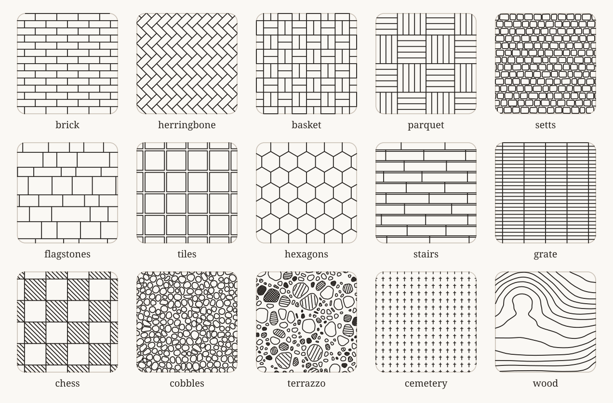

Paving, brickwork, tiles and the textures of built surfaces.

| Material | Spacing | Drawn with | What it is |
| --- | --- | --- | --- |
| `brick` | 1 mm | `tile` | Brickwork in running bond. |
| `herringbone` | 1.2 mm | `tile` | Pavers in herringbone. |
| `basket` | 1.2 mm | `tile` | Pavers in basket weave. |
| `parquet` | 1.2 mm | `tile` | Parquet blocks of boards, alternating. |
| `setts` | 1.2 mm | `tile` | Small stone setts in staggered courses: cobbled streets. |
| `flagstones` | 2 mm | `tile` | Irregular rectangular paving. |
| `tiles` | 1.6 mm | `tile` | Square tiles with a joint. |
| `hexagons` | 1.6 mm | `tile` | Hexagonal paving. |
| `stairs` | 1 mm | `tile` | Steps: treads and risers. |
| `grate` | 1 mm | `tile` | A grating of bars. |
| `chess` | 1.2 mm | `tile` | A chessboard, alternate squares hatched. |
| `cobbles` | 1.4 mm | `cells` | Rounded cobbles laid close. |
| `terrazzo` | 2.2 mm | `cells` | Stone chips of every size, some hatched, some inked. |
| `cemetery` | 2.4 mm | `scatter` | The cemetery symbol: crosses in rows. |
| `wood` | 1 mm | `wood` | Wood grain flowing round knots: planks, boards, timber. |

#### Sky

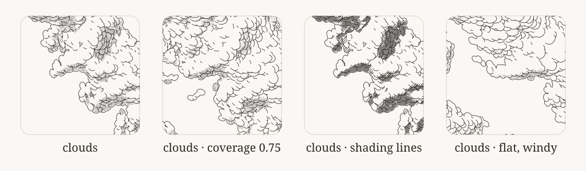

Clouds seen from above, and their shadows. The strip shows `clouds` at its defaults and with `coverage`, `shading: "lines"`, and a low, wind-stretched sky (`height`, `stretch`).

| Material | Spacing | Drawn with | What it is |
| --- | --- | --- | --- |
| `clouds` | 5 mm | `clouds` | Cumulus seen from above, shaded where they turn from the sun. |

#### Plain hatches

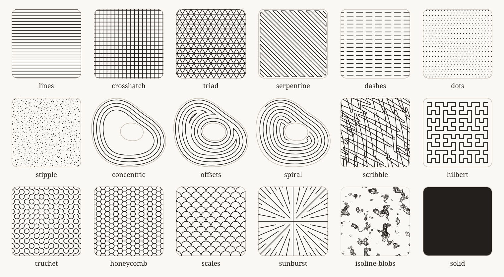

Lines, grids, dots and rings: abstract hatches for anything.

| Material | Spacing | Drawn with | What it is |
| --- | --- | --- | --- |
| `lines` | 0.6 mm | `hatch` | Parallel lines: the plain hatch. |
| `crosshatch` | 0.8 mm | `hatch` | Two families of lines crossing at right angles. |
| `triad` | 1 mm | `hatch` | Three families of lines at 60°: a triangular grid. |
| `serpentine` | 0.6 mm | `hatch` | Parallel lines joined end to end into one long stroke: the fastest hatch to plot. |
| `dashes` | 0.8 mm | `hatch` | Rows of even dashes. |
| `dots` | 0.6 mm | `scatter` | Dots on a hexagonal lattice. |
| `stipple` | 0.55 mm | `scatter` | Dots placed evenly but irregularly, like a stipple by hand. |
| `concentric` | 0.6 mm | `rings` | Rings inward from the outline; holes stop them. |
| `offsets` | 0.6 mm | `rings` | Rings from every edge, holes included, so networks such as streets fill evenly. |
| `spiral` | 0.6 mm | `rings` | One continuous spiral inward. |
| `scribble` | 1 mm | `scribble` | Loose hand scribble-hatching. |
| `hilbert` | 1 mm | `hilbert` | A Hilbert curve: one unbroken space-filling line. |
| `truchet` | 2 mm | `truchet` | Truchet arcs: a random maze of curves. |
| `honeycomb` | 2 mm | `honeycomb` | Hexagonal cells. |
| `scales` | 1.5 mm | `scales` | Overlapping scales. |
| `sunburst` | 1 mm | `sunburst` | Rays from a centre. |
| `isoline-blobs` | 10 mm | `isoline-blobs` | Contoured blobs, like a topographic map of islands. |
| `solid` | 1 mm | `solid` | Solid ink. |

### Symbols

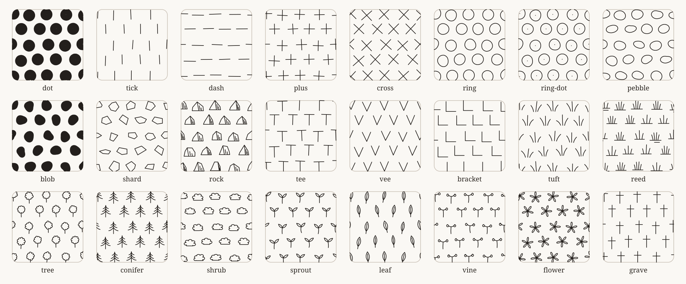

`scatter` draws one of these at each place (`motif`), `mark` mm tall, turned by `rotate` (`random`, `aligned`, `upright`, or degrees). They are drawn for a 0.25 mm pen: solid marks are filled with turns closer than the pen, and outlines keep their detail coarser than it. The library is [`src/catalog/marks.rs`](src/catalog/marks.rs) (`marks::NAMES`, `marks::draw`). For anything else, pass your own polylines as the `motif` ([below](#your-own-marks-and-tiles)).

---

## Edge fraying, boundary modes, and polygon masks

### Edge fraying (`fray`)

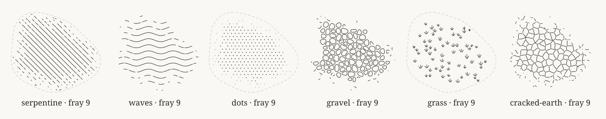

Setting `fray > 0` (in millimetres) makes the fill fade out over a band of that width inside the region's outline. A noisy survival weight rises from 0 at the boundary to 1 at depth `fray`, and [`fray_strokes`](src/fray.rs) adapts to what it is fraying:

1. **Continuous lines** (`lines`, `serpentine`, `waves`, `wood`, `marble`, `swells`, `eddies`, `hilbert`): deep inside the lines stay whole; further out they break into shorter and shorter dashes, then brief ticks, then nothing.
2. **Discrete marks** (`dots`, `stipple`, `grass`, `twigs`, `granite`): whole marks drop out toward the edge, and the survivors shrink toward their middle instead of being chopped.
3. **Closed rings and cells** (`gravel`, `honeycomb`, `pebbles`, `canopy`, `cracked-earth`): cells shrink toward their centre, drop out, and open into partial arcs in the outer band.

[`examples/gallery/fray.svg`](examples/gallery/fray.svg) shows twelve patterns from `fray = 0` to `fray = 9 mm`, with and without the outline.

### Boundary modes (`EdgeMode`) and masks (`FillOutput`)

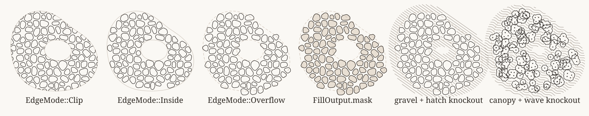

`edge` ([`EdgeMode`](src/pattern.rs)) decides how elements meet the boundary:

- **`"clip"` (`EdgeMode::Clip`, the default)**: elements run up to the boundary and are cut along it.
- **`"inside"` (`EdgeMode::Inside`)**: discrete elements (stones, scattered marks, crowns, tiles) are kept whole: an element that would cross the wall is left out, so no cut edges appear.
- **`("overflow", mm)` (`EdgeMode::Overflow(mm)`)**: elements whose centres lie inside may stick out past the boundary by up to `mm`, for a natural silhouette of foliage or stones.

Every fill can also return a polygon **`mask: Region`** with its strokes. Fills that know their own footprint (stones, scattered marks, crowns, clouds, contour blobs) register the shapes they cover; the others cover their area. Subtract the mask (outset by a small clearance) from the layers below and they never draw under the top layer:

```python
fg = penfill.fill_output(island, "gravel", 4.8, seed=7, edge=("overflow", 3.5))
bg_region = backdrop.difference(fg.mask.outset(0.35))
bg_strokes = penfill.lines(bg_region, 1.35, angle=35, anchor="global")
```

[`examples/gallery/edges-and-masks.svg`](examples/gallery/edges-and-masks.svg) compares the modes for `canopy`, `gravel`, `isoline-stack`, `pebbles`, and frayed `grass`.

---

## CAD hatch patterns

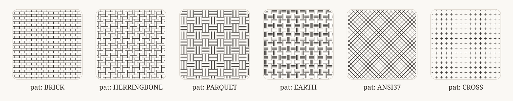

`penfill` reads standard AutoCAD / LibreCAD / QCAD `.pat` files and ships 14 built-in definitions: `ANSI31`, `ANSI32`, `ANSI33`, `ANSI37`, `BRICK`, `HERRINGBONE`, `BASKET`, `PARQUET`, `EARTH`, `CROSS`, `DASH`, `STAIRS`, `GRATE`, `ANGLE`. In the catalogue they are the `tile` generator's `pat` option, a built-in name or the text of a definition; one pattern unit is `spacing` mm:

```rust
let bricks = catalog::fill("tile", &shape, &Spec::default().spacing(1.6).option("pat", "BRICK")).unwrap();
let text = "*MYHATCH, my hatch\n45, 0,0, 0,2\n135, 0,0, 0,2, 1,-1\n";
let mine = catalog::fill("tile", &shape, &Spec::default().spacing(1.0).option("pat", text)).unwrap();
```

From Python and Node, `pat` takes the same definitions (`penfill.PATTERNS` lists the built-ins):

```python
bricks = penfill.pat(shape, "BRICK", scale=1.6, fray=6.0)

source = open("acad.pat").read()
print(penfill.pat_names(source))
custom_pat = penfill.pat(shape, "AR-PARQ1", scale=0.5, source=source)
```

[`examples/gallery/cad.svg`](examples/gallery/cad.svg) shows all fourteen.

---

## Pictures: dithering

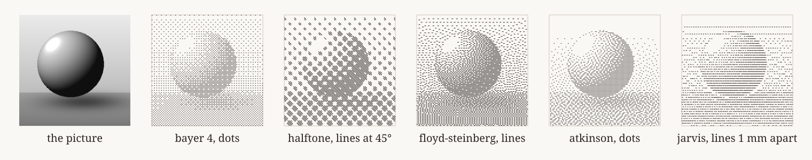

`dither` places an image over a region and turns its tone into strokes on a grid of `resolution × line_spacing` mm cells turned by `angle`:

- **`marks="lines"`** (default): adjacent dark cells along each scanline join into strokes, back and forth, for fast plotting.
- **`marks="dots"`**: a short tick on each dark cell.
- **`method`**: `"threshold"`, `"random"`, `"bayer2"` … `"bayer16"`, `"halftone2"` … `"halftone16"`, `"floyd-steinberg"` (default), `"atkinson"`, `"jarvis"`, `"stucki"`, `"sierra"`.

### Placing a picture or SVG: `size`, `position`, `repeat`

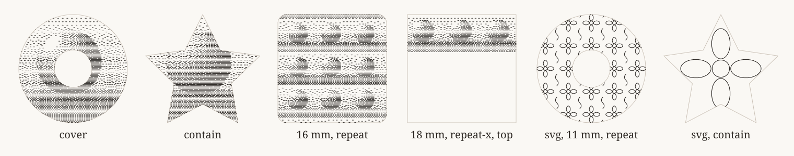

`dither` and `svg_fill` place their source like a CSS background, measured against the region's bounding box:

- **`size`**: `"cover"`, `"contain"`, `"fill"`, a width in mm (`14`, `"14mm"`, `"50%"`), or width and height (`"20 auto"`, `(40, 10)`).
- **`position`**: `"center"`, `"top left"`, `"bottom"`, `"25% 75%"`, `"5 10"`.
- **`repeat`**: `"no-repeat"` (default), `"repeat"`, `"repeat-x"`, `"repeat-y"`.

---

## Build your own pattern

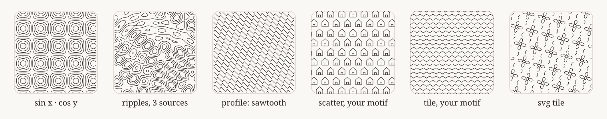

There are three ways to a new look, from least to most code.

**A new combination.** A material is only layered generators with settings: `meadow` is tufts scattered in noisy patches over a layer of seed dots, `chalk` is `tile` in brick bond under a fine `scatter` of grains. Every generator's options are open, so most new looks are a `Spec` away (`scatter` with `motif: "tuft"` and `density: "noise"` is a rough meadow), and you can layer two fills yourself.

<a id="your-own-marks-and-tiles"></a>**Your own marks and tiles.** `scatter` and `tile` take your own polylines as `motif`, in mm around the origin (up is negative y), drawn at their own size; `tile` repeats them on a lattice (`size` is the tile box, `stagger` the row offset):

```rust
use penfill::catalog::Value;

let house: penfill::Strokes = vec![vec![(-1.0, 1.0), (-1.0, -0.4), (0.0, -1.3), (1.0, -0.4), (1.0, 1.0), (-1.0, 1.0)]];
let village = catalog::fill("scatter", &shape, &Spec::default().spacing(4.0).option("motif", house.clone()).option("rotate", "upright")).unwrap();
let wallpaper = catalog::fill(
    "tile",
    &shape,
    &Spec::default().option("motif", house).option("size", Value::Nums(vec![3.0, 3.0])).option("stagger", 0.5),
)
.unwrap();
```

A host that only sends data (draw.land profiles, JSON) gets the same: motifs as polylines, `.pat` text, every option by name. From Python and Node, `tile(region, strokes, width, height)` and `svg_tile` / `svg_fill` repeat your own drawing, and `isolines(region, f, levels)` and `profile(...)` draw a function.

**A pattern in code.** Every built-in generator is written against the same [`Canvas`](src/pattern.rs) and [`Tools`](src/pattern.rs) that `pattern` / `fill_pattern_output` hand your function. The engine:

1. applies `inset` and resolves `canvas.limit` for the `edge` mode (`Clip`, `Inside`, or `Overflow(margin)`),
2. binds `Canvas` and `Tools` to the region, seed, spacing, angle, anchor, edge mode, and fray width,
3. runs your function to collect `Strokes` (and any mask shapes registered with `tools.add_mask_ring` / `tools.add_mask`),
4. clips the strokes to `canvas.limit`, frays them if `fray > 0` (unless your pattern called `tools.claim_fray()`), and builds the `FillOutput.mask`.

### `Canvas` reference

| Field | Description |
| --- | --- |
| `region` | The `Region` to fill (after `inset`) |
| `limit` | Clipping envelope (`region` for `Clip`/`Inside`, `region.outset(m)` for `Overflow(m)`) |
| `bounds` | `(min_x, min_y, max_x, max_y)` in mm |
| `origin` | The resolved anchor point `(x, y)`: build lattices through it |
| `spacing`, `angle`, `seed`, `fray` | The fill's parameters |
| `edge` | The `EdgeMode` (Rust) |
| `param(key, default)` | A custom numeric parameter |

### `Tools` standard library reference

| Category | Method | What it provides |
| --- | --- | --- |
| **Randomness and noise** | `rng()`, `rng_salted(salt)`, `cell_rng(i, j)` | Deterministic `SplitMix64` streams (`cell_rng` is per lattice cell, so it is safe with a global anchor) |
| | `noise(x, y, octaves)` | Multi-octave Perlin noise in `[-1, 1]` |
| **Frames and lattices** | `frame(angle)` | An anchored coordinate `Frame` (`world(uv)`, `local(xy)`, `span(region, pad)`) |
| | `grid(...)`, `grid_cells(...)` | Lattice cells inside the region (or across `limit` plus a margin), each with its own RNG |
| **Sampling and lines** | `scatter(spacing)`, `scatter_field(dense, sparse, field)` | Poisson-disk points, evenly or following `field(x, y) → [0, 1]` |
| | `hatch(spacing, angle)` | An anchored hatch clipped to the region |
| | `isolines(cell, levels, f)` | Contour lines of `f(x, y)` |
| | `profile(spacing, angle, f)` | Parallel lines bent by a 1-D function `f(x)` |
| **Cells** | `voronoi_cells(sites, reach)` | Voronoi cell rings |
| | `voronoi_edges(sites, reach)` | Voronoi walls, each once |
| **Shapes** | `circle(c, r)`, `lobe(c, r, phase, rough)`, `arc(c, r, a0, a1, steps)` | Rings, foliage lobes, arcs |
| | `tick(c, angle, half)`, `cross(c, half, twist)`, `x_cross(c, half, twist)` | Small marks |
| | `smooth(ring, rounds)`, `resample(pts, step)` | Chaikin corner cutting and even resampling |
| **Boundary and fray** | `border_ramp(pt, falloff, rough)` | A noisy `[0, 1]` ramp from the wall (`0`) to `falloff` mm in (`1`) |
| | `whole_at(pt)` | The fray weight at `pt` |
| | `element_fits(centre, radius)` | Whether a motif of that radius fits the `EdgeMode` |
| | `claim_fray()` | Your pattern frays its own marks; skip the stroke pass |
| **Masks and scoping** | `add_mask_ring(ring)`, `add_mask(region)`, `set_mask_halo(r)` | Add to `FillOutput.mask` |
| | `on(region)`, `seeded(salt)`, `with_spacing(s)`, `with_edge(e)`, `with_fray(f)` | Scoped copies for sub-regions or layers (Rust; Python and Node have `on`) |

### Example: whole Voronoi stones with a mask

**Python**

```python
import penfill

def my_stones(canvas, tools):
    strokes = []
    for ring in tools.voronoi_cells(tools.scatter(canvas.spacing), canvas.spacing * 1.8):
        stone = tools.smooth(ring, rounds=2)
        if all(canvas.region.contains(p) for p in stone):  # whole stones only
            tools.add_mask_ring(stone)
            strokes.append(stone)
    return strokes

out = penfill.pattern(shape, my_stones, spacing=4.0, seed=7, fray=6.0, with_mask=True)
```

**Rust**

```rust
use penfill::{fill_pattern_output, EdgeMode, FillParams};

let params = FillParams::new(4.0).seed(7).edge(EdgeMode::Inside).fray(6.0);
let out = fill_pattern_output(&shape, &params, |canvas, tools| {
    let sites = tools.scatter(canvas.spacing);
    let mut strokes = Vec::new();
    for (_, _, ring) in tools.voronoi_cells(&sites, canvas.spacing * 1.8) {
        let stone = tools.smooth(&ring, 2);
        if stone.iter().all(|&p| canvas.region.covers_point(p)) {
            tools.add_mask_ring(&stone);
            strokes.push(stone);
        }
    }
    strokes
});
```

---

## Any shape and the gallery

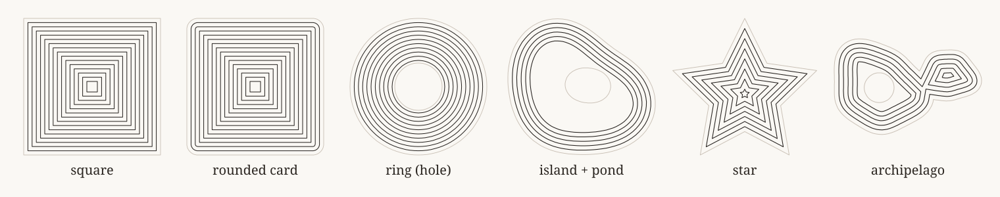

Holes, concave bays, sharp corners, and multi-polygon archipelagos are handled by every fill.

`cargo run --release --example gallery` draws every picture in this README and the sheets in [`examples/gallery/`](examples/gallery). The pattern pictures come from the catalogue itself (the materials by group, the generators, the symbols), so they cannot drift from what the library draws:

- **[`gallery.svg`](examples/gallery/gallery.svg)**: the whole catalogue by group, every material with its description, then every generator at its defaults, a sheet of options, and the symbols.
- **[`fray.svg`](examples/gallery/fray.svg)**: fraying from `0` to `9 mm` across lines, waves, marks and cells.
- **[`edges-and-masks.svg`](examples/gallery/edges-and-masks.svg)**: `Clip`, `Inside`, `Overflow(3.5)`, the mask, and a knocked-out lower layer.
- **[`cad.svg`](examples/gallery/cad.svg)**, **[`custom.svg`](examples/gallery/custom.svg)**, **[`dither.svg`](examples/gallery/dither.svg)**, **[`placement.svg`](examples/gallery/placement.svg)**: `.pat` hatches through `tile`, your own functions and motifs, dithering, and placement.

---

## Development

```
src/                 Rust core crate (`penfill`)
src/catalog/         The catalogue: generators, materials, symbols, self-description
bindings/python/     PyO3 module (`penfill-python`), built with maturin
bindings/node/       napi-rs addon (`penfill-node`)
bindings/wasm/       wasm-bindgen crate (`penfill-wasm`) for the web playground
examples/gallery.rs  Draws `examples/gallery/*.svg` and `docs/img/*.svg` from the catalogue
examples/catalog_sheet.rs  A contact sheet of any patterns and options, for reviewing them
docs/architecture/   Subsystem architecture documentation (start at INDEX.md)
```

```sh
cargo test                                             # unit and doc tests
cargo run --release --example gallery                  # regenerate the gallery and README pictures

# Look at patterns while working on them: every material and generator,
# or chosen cells (a name, then key=value options; `|` starts a new cell).
cargo run --release --example catalog_sheet -- sheet.svg
cargo run --release --example catalog_sheet -- sheet.svg hatch cross=2 '|' scatter motif=tuft density=noise
cargo run --release --example catalog_sheet -- --json   # the catalogue's self-description

cd bindings/python && maturin develop --release && pytest
cd bindings/node && npm install && npm run build && npm test
```

### Browser playground (WebAssembly)

```sh
./scripts/build-wasm.sh
cd web && npm install && npm run dev
```

## License

Licensed under either of [MIT](LICENSE-MIT) or [Apache-2.0](LICENSE-APACHE), at your option.
