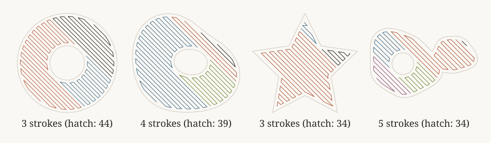

# penfill for Python

**Fills and hatches for pen plotters.** Give penfill a shape in millimetres
and it returns the polylines a pen should draw to fill it: serpentine
zigzags that barely lift the pen, spirals, lattices, stipple, gravel, grass,
marble, AutoCAD `.pat` hatches, dithered photos, your own functions or your own SVG tiles.
Every line stays inside the shape and goes around its holes.



```sh
pip install penfill
```

```python
import penfill

square = [(0, 0), (80, 0), (80, 60), (0, 60)]
hole = [(30, 20), (50, 20), (50, 40), (30, 40)]
shape = penfill.Region(square, holes=[hole])

strokes = penfill.fill(shape, "serpentine", 1.0, angle=45)   # list of polylines, in drawing order
open("serpentine.svg", "w").write(penfill.to_svg(strokes, outline=shape))
```

Every pattern in the catalogue is a name: materials such as `"gravel"`,
`"marsh"`, `"limestone"`, `"herringbone"`, and the generators under them
(`"hatch"`, `"scatter"`, `"cells"`, …). `penfill.FILLS` lists them; numeric
options go in `custom`:

```python
stones = penfill.fill(shape, "gravel", 2.0, fray=8.0, seed=7)
grid = penfill.fill(shape, "hatch", 0.8, custom={"cross": 2})
```

Photos and SVGs are placed like a CSS background, then clipped to the shape:

```python
strokes = penfill.dither(shape, "portrait.jpg", size=14, repeat="repeat", method="atkinson")
```

The engine is written in Rust and ships as a prebuilt wheel for Linux,
macOS and Windows (one wheel for every Python ≥ 3.9). Nothing to compile.

Every fill, with pictures: **[github.com/pileoni/penfill](https://github.com/pileoni/penfill)**

License: MIT OR Apache-2.0.
